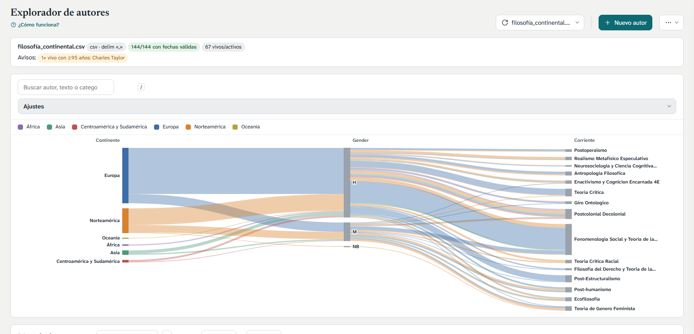

# Explorador de autores

Visor estático de autores: lee `.csv` y `.json` de `data/` y dibuja un
**Sankey** de dimensiones y una **línea de tiempo**, con una ficha lateral
editable. HTML + JavaScript sin compilación ni dependencias instaladas (D3 se
carga por CDN).



## Estructura

| Archivo              | Responsabilidad                                                       |
| -------------------- | --------------------------------------------------------------------- |
| `index.html`         | Marcado, estilos y tokens de diseño (todo el CSS vive aquí).          |
| `dataset.js`         | Lee CSV/JSON, normaliza fechas y autores, detecta dimensiones.        |
| `app.js`             | Orquesta: dibuja Sankey y línea de tiempo, filtros, búsqueda, export. |
| `panel.js`           | Ficha lateral, descripciones, edición, deshacer y notas `.meta.json`. |
| `folder-selector.js` | Selector de dataset (lista `data/`, carpeta o archivos sueltos).      |
| `data/`              | Datasets (`.csv`/`.json`) y `manifest.json` con la lista de archivos. |

## Cómo abrirlo

Sirve la carpeta por HTTP para poder listar `data/`:

```sh
python -m http.server 8000
```

Luego abre <http://localhost:8000/>. Abierto con `file://`, el navegador
bloquea la lectura del directorio: usa **Carpeta…** / **Archivo…** del selector
o añade un `data.js` opcional con `window.DEFAULT_DATA`.

## Columnas del CSV

Una fila por autor. El separador (`,` `;` o tabulador) se detecta solo, y los
campos entrecomillados pueden contener saltos de línea. Los nombres de columna
se reconocen sin distinguir mayúsculas ni acentos.

| Campo                    | Nombres aceptados                                                       |
| ------------------------ | ----------------------------------------------------------------------- |
| **Nombre** (obligatorio) | `nombre`, `autor`, `author`, `title`, `label`                           |
| Nacimiento               | `nacimiento`, `birth`, `born`, `birth_year`, `fecha_nacimiento`…        |
| Muerte                   | `muerte`, `death`, `died`, `death_year`, `fallecimiento`…               |
| Intervalo de vida        | `vida`, `years`, `años`                                                 |
| Años de actividad        | `años_actividad`, `years_active`, `activity`, `period`                  |
| Dimensiones              | Cualquier otra columna con valores repetidos (país, corriente, género…) |

Reglas de valores:

- Fechas antes de Cristo: `-350` o `350 a.C.`.
- Fecha aproximada: `?`, `c.` o `ca.` delante del año.
- Persona viva: `present` o `actualidad`.
- Varios valores en una celda: sepáralos con `|`.
- Celda vacía: se muestra como `(vacío)` y cuenta como categoría propia.

Las columnas de dimensiones se detectan automáticamente: se necesitan al menos
2 valores distintos, como máximo 100, longitud media ≤ 100 caracteres y
cobertura ≥ 50 % de las filas. Además se generan dimensiones derivadas de las
fechas (estado, siglo y cohorte de nacimiento y actividad).

El mismo formato vale en JSON (lista de objetos; las claves anidadas se
aplanan a `padre.hijo`).

## Añadir un dataset

1. Copia el `.csv` o `.json` a `data/`.
2. Añade su nombre a `data/manifest.json`:
   `{"files": ["nuevo.csv"]}` (o una lista `["nuevo.csv"]`).
3. En la app pulsa **Recargar lista** y elige el archivo en el selector.

También puedes cargar archivos sin tocar el repositorio con **Carpeta…** o
**Archivo…** en el mismo selector.

## Uso

- **Buscar**: escribe en la barra superior o pulsa `/` (resultados abren la
  ficha; `Esc` limpia).
- **Sankey**: cada columna es una dimensión. Clic en una forma filtra (fija la
  selección); clic en una etiqueta abre la ficha. La leyenda va en orden
  alfabético y un clic filtra. **Ajustes** controla columnas, color, orden,
  cohorte y texto en los nodos.
- **Línea de tiempo**: línea fina = vida, barra = años activos, discontinua =
  sigue vivo/activo. La columna de nombres queda fija y solo el gráfico se
  desplaza en horizontal. **Orden** agrupa por el campo elegido. La casilla al
  final de cada fila oculta al autor (el aviso «n ocultos · Mostrar» los
  recupera) y los campos **Fechas** limitan el periodo visible.
- **Ficha**: edita campos, añade o borra autores, deshace y rehace, y exporta
  en CSV o JSON. **Notas (.meta.json)** guarda descripciones y cambios;
  **Importar notas…** los recupera. Los cambios también persisten en
  `localStorage` del navegador.
- **Vistas**: `Alt`+`←` vuelve a la vista anterior; **Restablecer vista**
  devuelve columnas, color y orden por defecto.

La ayuda con todo esto también está dentro de la app, en el botón
**¿Cómo funciona?**.
